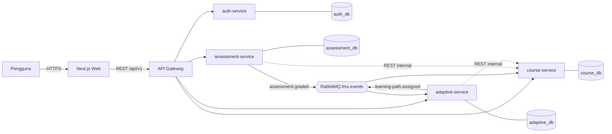
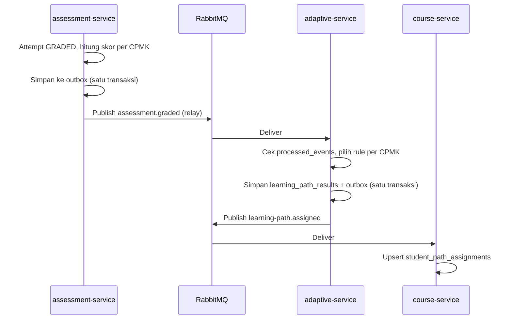

# 03 — System Architecture

Keputusan dan alasan lengkap ada di [adr/](adr/README.md). Dokumen ini menjelaskan **apa dan bagaimana**. Diagram: [diagrams/](diagrams/README.md).

## 1. Gambaran Tingkat Tinggi

Gaya arsitektur: **microservices berbasis domain** dengan 4 layanan bisnis + 1 gateway, komunikasi sinkron REST dan asinkron lewat RabbitMQ. `APPROVED` (brief, Q3, Q4)



## 2. Komponen dan Tanggung Jawab

| ID | Komponen | Tanggung jawab | Tidak boleh |
|---|---|---|---|
| CMP-WEB | Next.js + Tailwind | UI, routing per peran, memanggil gateway | Menyimpan logika bisnis penilaian/adaptif |
| CMP-GW | Gateway (Express) | Routing, validasi JWT awal, CORS, rate limit, `correlationId` | Logika domain, akses DB |
| CMP-AUTH | auth-service | Pengguna, peran, hash password, penerbitan/rotasi token, audit log | Mengetahui data mata kuliah |
| CMP-CRS | course-service | Mata kuliah, CPMK, silabus, materi, enrollment, visibilitas jalur | Menilai atau menghitung rule |
| CMP-ASM | assessment-service | Soal, attempt, penilaian, skor per CPMK, publikasi `assessment.graded` | Menentukan jalur belajar |
| CMP-ADP | adaptive-service | Rule, evaluasi rule, simpan keputusan, publikasi `learning-path.assigned` | Mengubah nilai |
| CMP-DB | PostgreSQL (1 instance, 4 database) | Persistensi per layanan | Join/FK lintas database |
| CMP-MQ | RabbitMQ | Transport event | Menyimpan data bisnis jangka panjang |

**Kepemilikan data:** hanya pemilik layanan yang boleh membaca/menulis databasenya. Layanan lain memakai API atau event.

## 3. Arsitektur Frontend

- Next.js (App Router, TypeScript), Tailwind CSS. Pendekatan SPA-like: halaman dilindungi di sisi klien/middleware sesuai peran.
- Access token disimpan **di memori** (bukan localStorage). Refresh token berupa cookie `HttpOnly; Secure; SameSite=Strict` terbatas pada path refresh (lihat [08](08-security-guidelines.md)).
- Lapisan: `app/` (route) → `features/` (UI per domain) → `lib/api` (client REST bertipe) → `components/ui`.
- Penanganan error: error boundary per route, pesan dari `error.code` API.
- Validasi form memakai skema Zod yang selaras dengan kontrak API.

## 4. Arsitektur Backend (per layanan)

Setiap layanan: Express + TypeScript dengan layering `routes → controllers → services → repositories`, ditambah `events/` (publisher, consumer). Rincian di [06](06-coding-guidelines.md).

## 5. Alur Request dan Response

1. Browser memanggil `https://<domain>/api/v1/...`.
2. Reverse proxy (Nginx/Caddy, `TBD`) meneruskan `/api` ke Gateway dan `/` ke Next.js.
3. Gateway: buat/teruskan `X-Correlation-Id`, rate limit, verifikasi JWT, lalu proxy ke layanan tujuan di jaringan internal.
4. Layanan **memverifikasi ulang JWT** (public key) dan melakukan otorisasi (peran + kepemilikan) lalu menjalankan logika.
5. Respons memakai format baku (lihat [05](05-api-design.md)).

## 6. Autentikasi dan Otorisasi

- JWT **RS256**. Auth memegang private key dan layanan lain hanya public key. `APPROVED` (Q7)
- Access token ±15 menit, refresh token ±7 hari dengan rotasi dan deteksi reuse. `PROPOSED` (nilai TBD)
- Claim: `sub`, `role`, `iss`, `iat`, `exp`, `jti`.
- Otorisasi 2 lapis: **peran** (middleware `requireRole`) dan **kepemilikan/keanggotaan** (dosen pemilik, mahasiswa ter-enroll).
- Layanan lain memeriksa kepemilikan/enrollment lewat endpoint internal course-service (C-22), diautentikasi `X-Internal-Key` (placeholder env) dan hanya terjangkau dari jaringan Docker internal. `PROPOSED`

## 7. Komunikasi Antarlayanan

| Jenis | Dipakai untuk | Alasan |
|---|---|---|
| REST sinkron (via gateway) | Permintaan dari frontend | Sederhana dan mudah diuji |
| REST internal | Cek akses/CPMK ke course-service | Dibutuhkan jawaban langsung. Timeout 3 s, 1 retry |
| RabbitMQ | Penilaian selesai → jalur belajar | Pemisahan beban dan ketahanan (NFR-002) |

### Katalog Event

Exchange: `lms.events` (topic, durable). Envelope:

```json
{
  "eventId": "uuid",
  "eventType": "assessment.graded",
  "version": 1,
  "occurredAt": "2026-10-15T08:00:00Z",
  "correlationId": "uuid",
  "payload": {}
}
```

| Event | Producer | Consumer | Payload (ringkas) |
|---|---|---|---|
| `assessment.graded` | assessment | adaptive | `attemptId, assessmentId, courseId, studentId, totalScore, competencyScores[{competencyId, score, maxPoints}], gradedAt` |
| `learning-path.assigned` | adaptive | course | `studentId, courseId, assessmentId, attemptId, decisions[{competencyId, pathType, score, ruleId}], decidedAt` |

| Queue | Binding | DLQ |
|---|---|---|
| `adaptive.assessment-graded` | `assessment.graded` | `adaptive.assessment-graded.dlq` |
| `course.learning-path-assigned` | `learning-path.assigned` | `course.learning-path-assigned.dlq` |

Kebijakan (ADR-006, `PROPOSED`): publikasi lewat **transactional outbox**, delivery at-least-once, consumer idempoten via `processed_events(event_id)`, retry 3× dengan backoff (queue retry berbasis TTL), lalu DLQ. Event bersifat *versioned* dan perubahan payload harus kompatibel mundur.

## 8. Alur Pemrosesan Data Adaptif



Algoritma pemilihan rule (BR-004): untuk tiap `competencyScores[i]`, cari rule aktif scope CPMK → scope mata kuliah → global. Ambil rule yang rentangnya memuat skor, lalu simpan hasil. Pseudocode dan diagram lengkap ada di [diagrams/activity-flow.md](diagrams/activity-flow.md).

## 9. Integrasi Pihak Ketiga

Tidak ada layanan eksternal wajib (`APPROVED`). Materi hanya tautan eksternal yang ditampilkan sebagai link (tanpa embed) agar tidak menambah risiko keamanan.

## 10. Penanganan Error

- Format error baku dengan `code`, `message`, `details`, `correlationId` ([05](05-api-design.md)).
- Error domain memakai kelas turunan `AppError` dan satu error-handler terpusat per layanan.
- Kesalahan tak terduga → 500 dengan pesan generik, detail hanya di log.
- Panggilan antarlayanan: timeout, 1 retry, lalu 503 `UPSTREAM_UNAVAILABLE`.
- Consumer: retry → DLQ, dan setiap kegagalan dicatat di log dengan `eventId`.

## 11. Logging dan Monitoring

- Log JSON ke stdout (pino, `PROPOSED`) dengan `timestamp, level, service, correlationId, userId?, msg`. Tidak boleh mencatat password, token, atau isi jawaban esai.
- `/health` (proses hidup) dan `/ready` (DB dan MQ terhubung) per layanan, dipakai healthcheck Compose.
- Monitoring minimal: `docker compose logs`, RabbitMQ Management UI (jumlah pesan DLQ), dan pengecekan uptime sederhana. Prometheus/Grafana `Could` (tidak wajib).

## 12. Skalabilitas dan Maintainability

- Layanan stateless sehingga dapat direplikasi (`docker compose up --scale`) di belakang gateway. Catatan: rate limit in-memory di gateway hanya akurat untuk 1 replika (`TBD` bila gateway direplikasi).
- Consumer kompetitif pada queue yang sama aman karena idempotensi.
- Paket `packages/shared` hanya berisi tipe, skema event, dan kelas error, **bukan logika bisnis**, untuk mencegah coupling.

## 13. Keputusan Arsitektur, Alasan, dan Trade-off

| Keputusan | Alasan | Alternatif ditolak |
|---|---|---|
| Microservices 4 domain | Sesuai tujuan penelitian dan batas domain jelas | Monolith (tidak memenuhi tujuan riset) dan lebih dari 4 layanan (berlebihan) |
| Gateway Express | Satu titik masuk, JWT, rate limit, sederhana | Nginx saja (tidak memahami JWT tanpa modul tambahan) dan Kong/Traefik (kompleksitas operasional) |
| 1 instance PG, 4 database | Hemat resource namun tetap terisolasi | 4 instance (boros), schema bersama (coupling) |
| RabbitMQ topic exchange | Fleksibel, ekosistem Node matang | Kafka (berlebihan), polling REST (coupling dan tidak tahan gagal) |
| Outbox | Konsistensi simpan-lalu-publish | Publish langsung (risiko event hilang) |
| Docker Compose | Cocok untuk skala dan sumber daya | Kubernetes (berlebihan) |

**Risiko arsitektural:** kompleksitas operasional (6+ container) untuk 1 developer, eventual consistency pada jalur belajar (selisih beberapa detik), dan duplikasi referensi ID lintas layanan. Mitigasi: Compose terstandar, UI menampilkan status "jalur sedang diproses", validasi referensi lewat API internal.
