# 07 — Development Roadmap

Urutan mengikuti dependensi nyata: **Auth → Course → Assessment → Adaptive → integrasi**. Estimasi durasi `TBD` (bergantung tenggat skripsi, Q9 belum menyebut tanggal). Satu developer sehingga tahap dikerjakan berurutan.

```mermaid
flowchart LR
    T0[0 Persetujuan dokumen] --> T1[1 Fondasi repo & infra]
    T1 --> T2[2 Database & migration]
    T2 --> T3[3 Auth & Gateway]
    T3 --> T4[4 Course & Content]
    T4 --> T5[5 Assessment]
    T5 --> T6[6 Adaptive & Event]
    T6 --> T7[7 Frontend]
    T7 --> T8[8 Integrasi E2E & uji beban]
    T8 --> T9[9 Security review]
    T9 --> T10[10 Deployment & dokumentasi operasional]
```

> Frontend dikerjakan **per fitur bersamaan dengan backend-nya** (vertical slice) mulai Tahap 3. Tahap 7 mencakup penyelesaian dan penyempurnaan UI. `PROPOSED`

## Tahap 0 — Validasi dan Persetujuan Dokumen
- **Tujuan:** dokumen disetujui.
- **Tugas:** tinjau dokumen, putuskan ADR `Proposed`/`TBD`, jawab pertanyaan terbuka.
- **Dependensi:** —
- **Output:** dokumen berstatus disetujui, ADR-007 (ORM) diputuskan.
- **Kriteria selesai:** checklist kesiapan (bagian akhir dokumen ini) terpenuhi.
- **Pengujian:** —

## Tahap 1 — Fondasi Repository dan Infrastruktur Lokal
- **Tujuan:** kerangka monorepo dan Compose dasar berjalan.
- **Tugas:** inisialisasi monorepo (workspaces), TypeScript/ESLint/Prettier, `.env.example`, Compose (PostgreSQL, RabbitMQ), pembuatan 4 database dan role, template layanan (health, logger, error handler, config), verifikasi versi Node/Next/Express ke dokumentasi resmi lalu pin.
- **Dependensi:** Tahap 0.
- **Output:** repo terstruktur, `docker compose up` menjalankan PG, RabbitMQ, dan layanan kosong dengan `/health`.
- **Kriteria selesai:** lint dan typecheck lulus, CI dasar hijau, tidak ada secret di repo.
- **Pengujian:** tes smoke `/health`, NFR-009 (parsial).

## Tahap 2 — Database dan Migration
- **Tujuan:** skema sesuai [04](04-database-design.md).
- **Tugas:** migration per layanan, seed default (rule global, admin awal), seed dev.
- **Dependensi:** Tahap 1, ADR-007.
- **Output:** migration dan seed teruji naik dari DB kosong.
- **Kriteria selesai:** migrate dari nol sukses, constraint terverifikasi, ERD sesuai skema.
- **Pengujian:** tes migrasi, tes constraint (CHECK/UNIQUE).

## Tahap 3 — Auth Service dan Gateway (+ UI login)
- **Tujuan:** autentikasi dan RBAC berfungsi (FR-001–008).
- **Tugas:** pembuatan keypair dev, login/refresh/logout/me, CRUD pengguna, impor CSV, `requireRole`, gateway (routing, JWT, rate limit, correlationId), UI login dan manajemen pengguna.
- **Dependensi:** Tahap 2.
- **Output:** A-01–A-11, gateway.
- **Kriteria selesai:** AC FR-001/006 terpenuhi, rotasi dan reuse refresh token teruji.
- **Pengujian:** TC-AUTH, TC-USER, TC-RBAC.

## Tahap 4 — Course & Content Service
- **Tujuan:** manajemen kuliah dan materi (FR-010–016).
- **Tugas:** mata kuliah, CPMK, silabus, materi, enrollment, endpoint internal C-22, visibilitas BR-009 (tanpa jalur dulu), UI dosen dan mahasiswa.
- **Dependensi:** Tahap 3.
- **Output:** C-01–C-20, C-22.
- **Kriteria selesai:** AC FR-013, kepemilikan dosen dan enrollment tegas.
- **Pengujian:** TC-CRS, TC-CNT, TC-ENR.

## Tahap 5 — Assessment Service
- **Tujuan:** evaluasi hibrida dan penilaian (FR-020–031).
- **Tugas:** evaluasi dan soal, attempt dan autosave, auto-submit, penilaian PG, penilaian esai, skor per CPMK (fungsi murni), tabel outbox dan relay (publikasi ke RabbitMQ), UI evaluasi dan penilaian.
- **Dependensi:** Tahap 4 (C-22), RabbitMQ dari Tahap 1.
- **Output:** S-01–S-16, event `assessment.graded` di outbox.
- **Kriteria selesai:** AC FR-026/028, tepat satu event per attempt GRADED.
- **Pengujian:** TC-ASM, TC-ATT, TC-GRD.

## Tahap 6 — Adaptive Service dan Event
- **Tujuan:** penetapan jalur otomatis (FR-040–046, FR-017).
- **Tugas:** CRUD rule dan validasi rentang, consumer `assessment.graded` (idempoten), pemilihan rule (fungsi murni), simpan hasil dan outbox, publikasi `learning-path.assigned`, consumer di course-service, retry/DLQ, API P-01–P-07, C-21, UI rule dan jalur.
- **Dependensi:** Tahap 5.
- **Output:** engine dan alur event ujung ke ujung.
- **Kriteria selesai:** AC FR-017/042/046, event duplikat tidak mengubah hasil.
- **Pengujian:** TC-RULE, TC-ADP, TC-PATH, tes ketahanan NFR-002/007.

## Tahap 7 — Penyelesaian Frontend
- **Tujuan:** UI utuh dan konsisten ([standards/ui-ux-guidelines.md](standards/ui-ux-guidelines.md)).
- **Tugas:** dashboard per peran, state loading/empty/error/success, responsif, aksesibilitas dasar.
- **Dependensi:** Tahap 3–6.
- **Output:** UI lengkap fitur Must dan Should.
- **Kriteria selesai:** kriteria penerimaan desain terpenuhi.
- **Pengujian:** tes komponen, uji manual responsif.

## Tahap 8 — Integrasi, E2E, dan Uji Beban
- **Tujuan:** bukti SC-02, SC-04, SC-05.
- **Tugas:** E2E untuk 3 alur kritis (login, submit→jalur, atur rule), uji ketahanan (matikan adaptive lalu hidupkan), uji beban k6.
- **Dependensi:** Tahap 7.
- **Output:** laporan pengujian.
- **Kriteria selesai:** semua TC Must lulus, NFR-001 terpenuhi.
- **Pengujian:** TC-E2E, TC-RES, TC-LOAD.

## Tahap 9 — Security Review
- **Tujuan:** kontrol di [08](08-security-guidelines.md) terverifikasi.
- **Tugas:** checklist keamanan, audit dependensi, uji RBAC menyeluruh, tinjau header/cookie/CORS, uji rate limit.
- **Dependensi:** Tahap 8.
- **Output:** laporan temuan dan perbaikan.
- **Kriteria selesai:** tidak ada temuan High/Critical terbuka.
- **Pengujian:** TC-SEC.

## Tahap 10 — Deployment dan Dokumentasi Operasional
- **Tujuan:** sistem berjalan di VPS (atau Compose lokal) sesuai [10](10-deployment-guide.md).
- **Tugas:** Compose produksi, reverse proxy dan HTTPS (jika ada domain), backup dan uji restore, runbook.
- **Dependensi:** Tahap 9, spesifikasi VPS dan domain (TBD).
- **Output:** deployment berjalan, dokumen operasional.
- **Kriteria selesai:** smoke test produksi lulus, restore teruji.
- **Pengujian:** TC-DEP.

## Checklist Kesiapan Sebelum Coding

- [ ] Pengguna menyetujui dokumen 01–10 dan direktori `adr/`, `diagrams/`, `standards/`.
- [ ] ADR-007 (ORM) diputuskan.
- [ ] Rule default global dan BR-006 (attempt terbaru menggantikan) dikonfirmasi.
- [ ] Kebijakan tampilan kunci jawaban (BR-014) dikonfirmasi.
- [ ] Penyedia VPS, spesifikasi, dan domain diketahui, atau diputuskan memakai Compose lokal dahulu.
- [ ] Tenggat dan estimasi durasi per tahap ditetapkan.
- [ ] Tujuan perbandingan monolith (AS-07) diputuskan, dan jika ya, NFR/pengujian ditambah.
- [ ] Kebijakan data pribadi kampus dikonfirmasi (AS-08).
- [ ] Repository dan platform CI (mis. GitHub) ditentukan.
- [ ] Versi Node.js LTS dan framework diverifikasi ke dokumentasi resmi (dikerjakan di Tahap 1).
