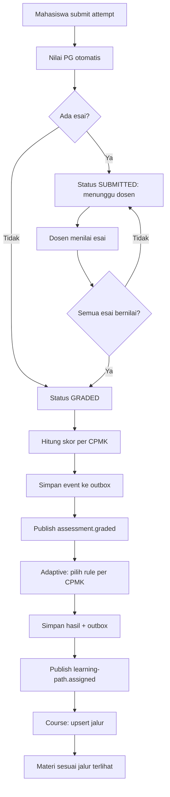
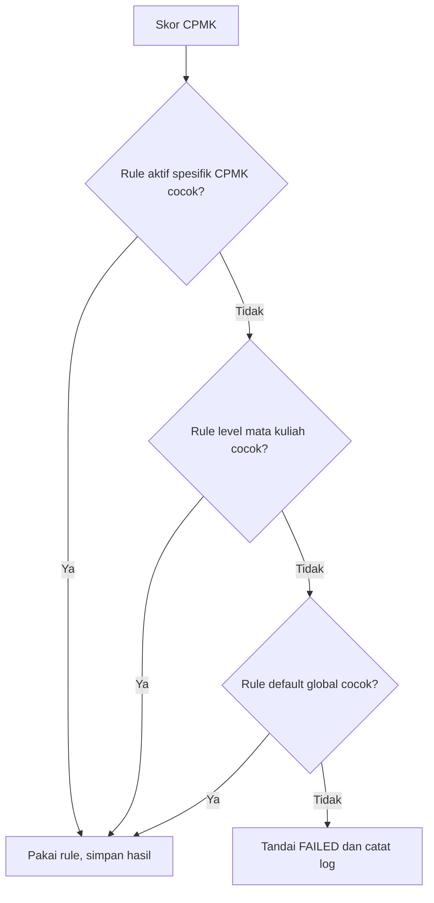

# Activity Flow

**Tujuan:** alur bisnis penilaian hingga jalur belajar, dan algoritma pemilihan rule. **Status:** DRAFT.

## Dari submit hingga jalur



## Pemilihan rule per CPMK (BR-004)



Pseudocode:

```
for each (competencyId, score) in event.competencyScores:
    rule = firstMatch([rulesForCompetency, rulesForCourse, globalRules], score)
    # cocok bila min <= score < max, atau max == 100 dan score <= 100
    save result(rule ? ASSIGNED : FAILED)
```
