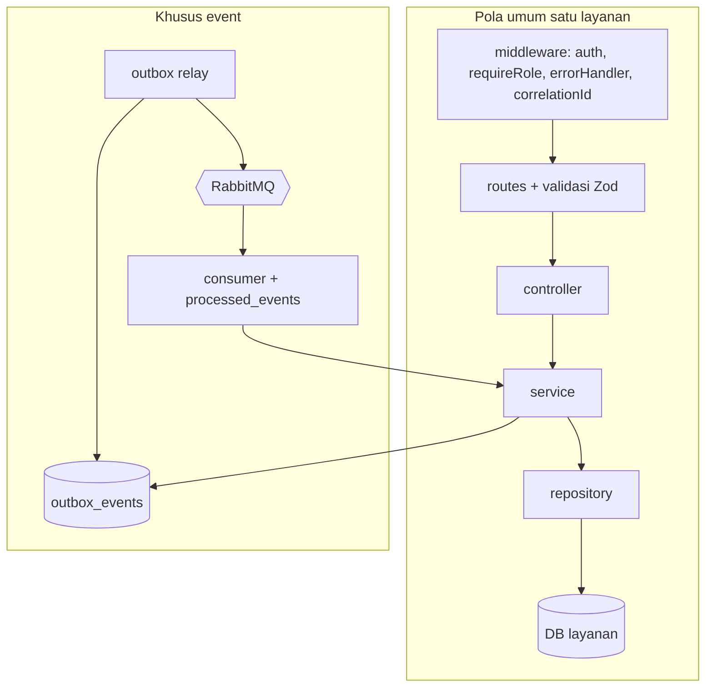
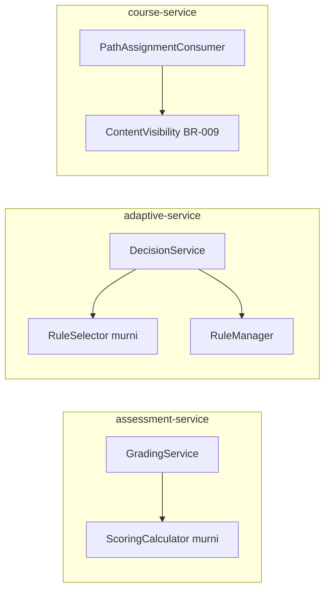

# Component Diagram

**Tujuan:** komponen internal layanan (pola yang sama di semua layanan) dan komponen khusus event. **Status:** DRAFT.

Komponen bertanda "murni" tidak melakukan I/O, dan wajib mendapat unit test paling lengkap.
