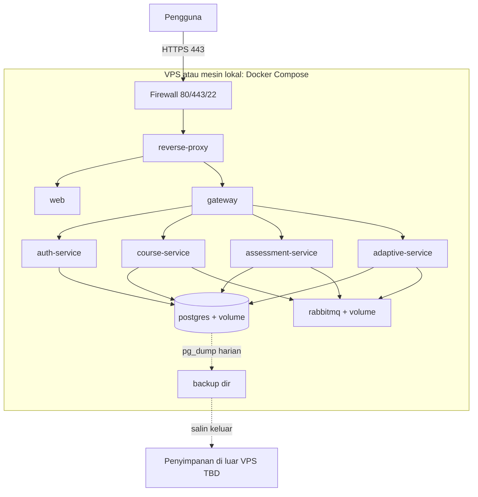

# Deployment Diagram

**Tujuan:** lingkungan eksekusi. **Status:** DRAFT. Spesifikasi VPS dan domain `TBD` ([10](../10-deployment-guide.md)).

Hanya reverse-proxy yang memiliki port publik. Jaringan Docker internal untuk lainnya.
