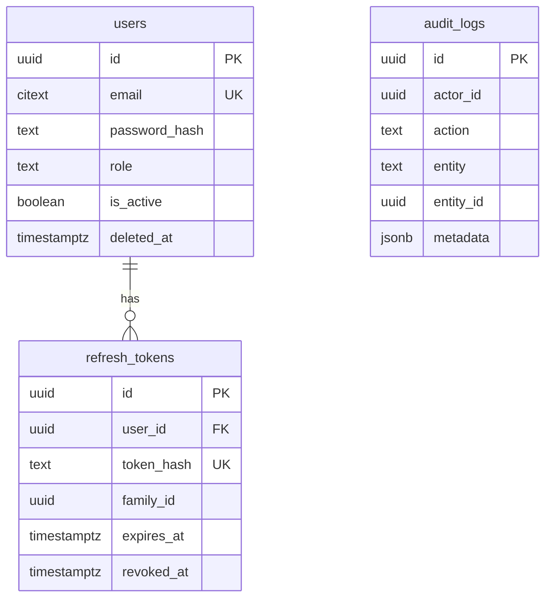
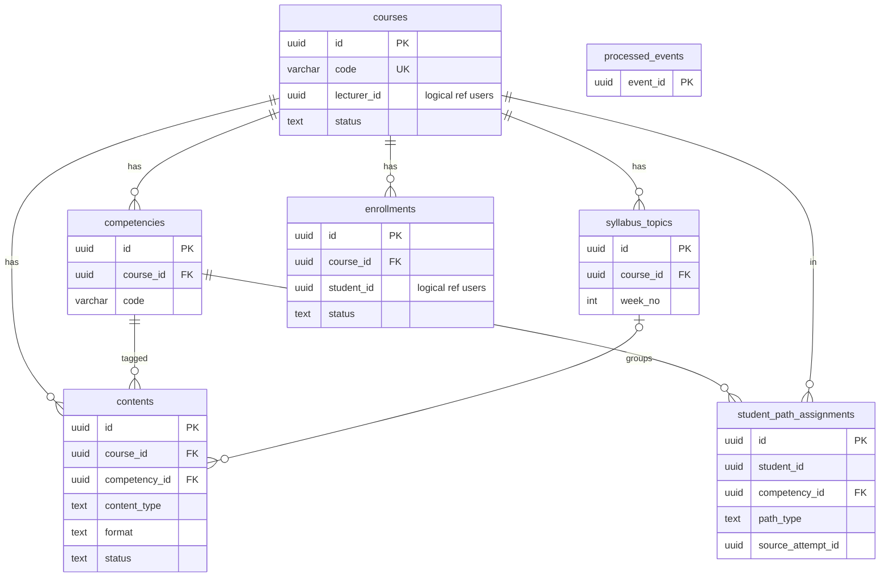
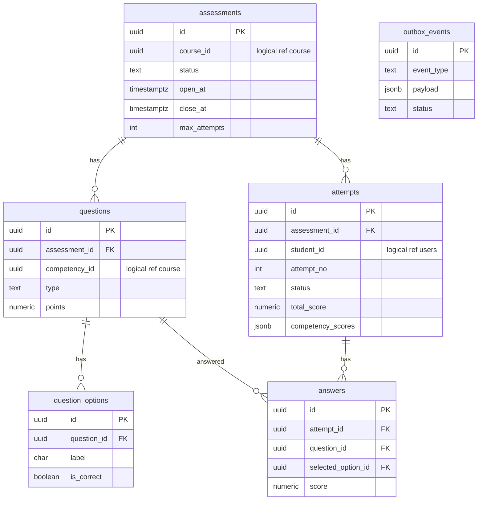
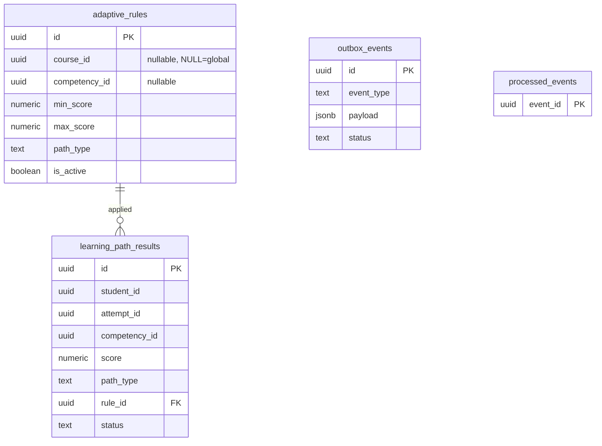

# ERD

**Tujuan:** struktur data per layanan. **Status:** DRAFT. Detail kolom: [04](../04-database-design.md). Atribut bertanda "logical ref" adalah referensi lintas layanan, **bukan foreign key**.

## auth_db

## course_db

## assessment_db

## adaptive_db

