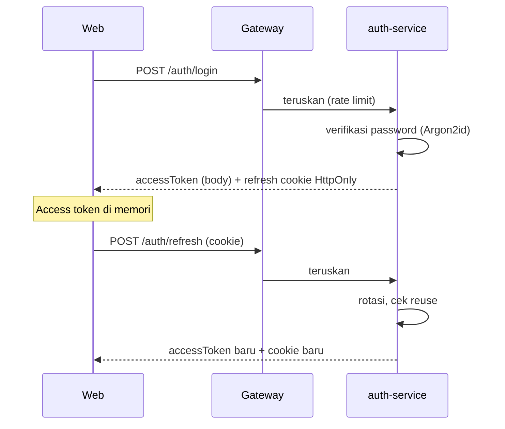
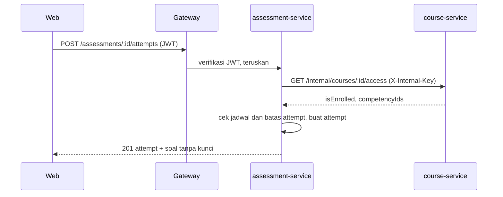
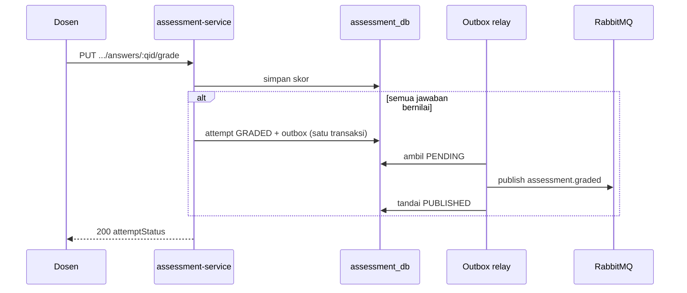
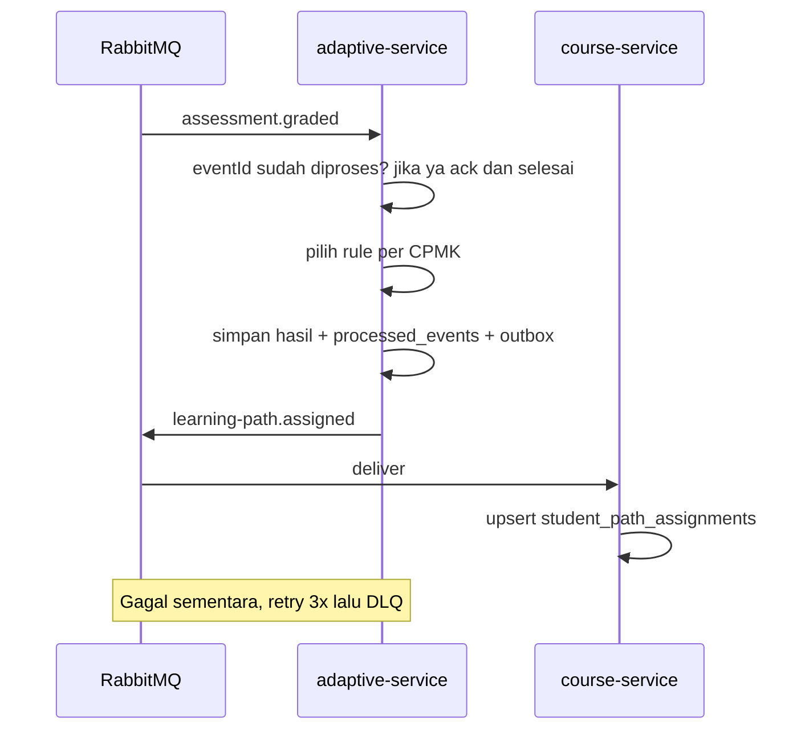
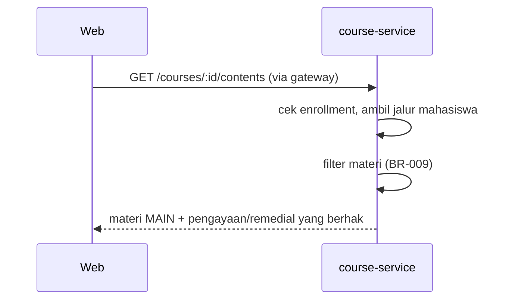

# Sequence Diagrams

**Status:** DRAFT. Alur data end-to-end juga tergambar di sini dan [03 §8](../03-system-architecture.md).

## SD-01 Login dan refresh

## SD-02 Mulai attempt (cek akses)

## SD-03 Penilaian esai dan publikasi event

## SD-04 Keputusan adaptif

## SD-05 Mahasiswa melihat materi sesuai jalur

